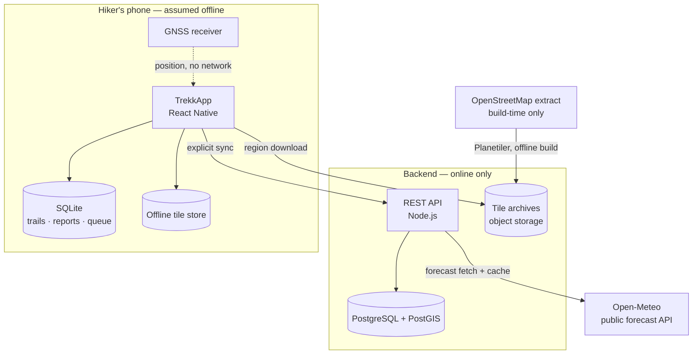
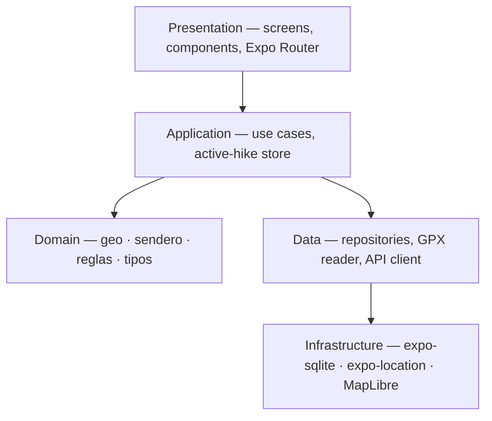
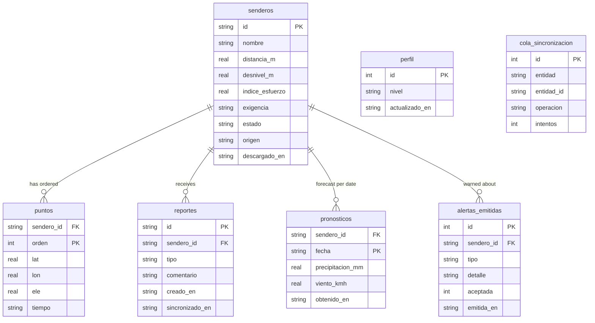
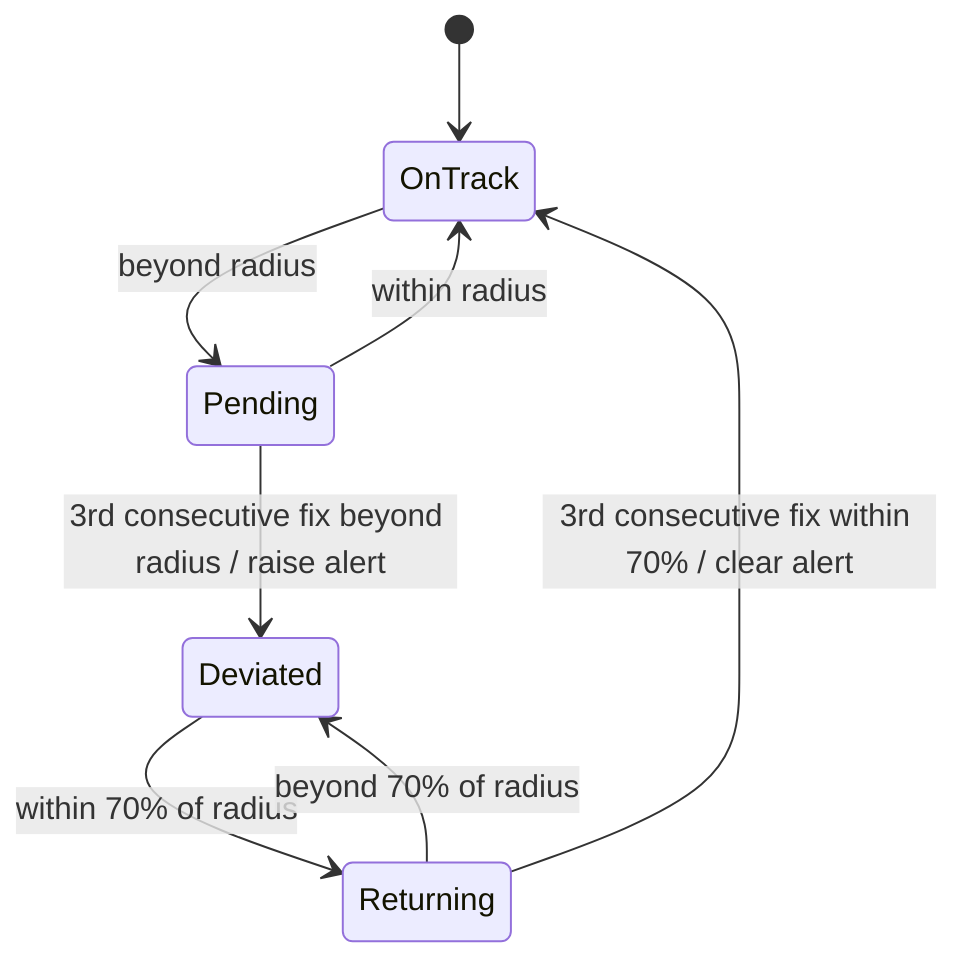
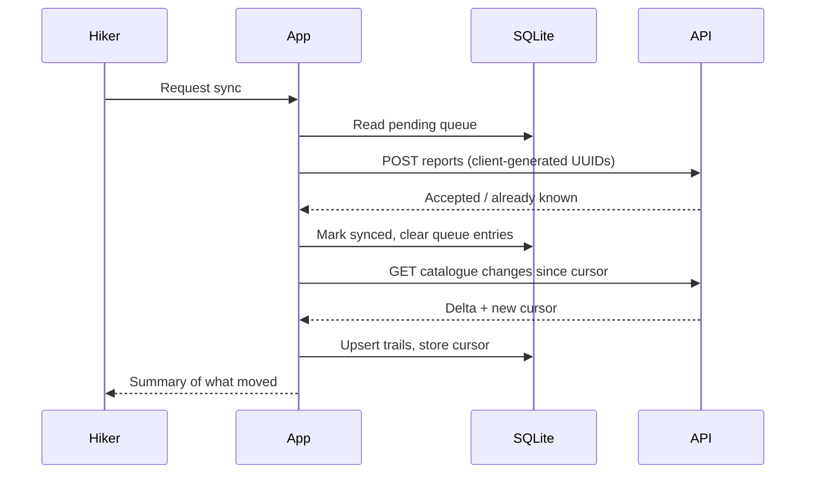

# TrekkApp — Architecture

Source of truth for the technical design. Any change to the stack, the module
boundaries, the sync contract or the data model must be reflected here first.

- **Product**: mobile application for planning and navigating mountain trails
  without connectivity, with deviation alerts, experience-level gating and
  weather warnings.
- **Field of use**: Sierras de Córdoba, Argentina. No cellular coverage on the
  trail; no recharging in the field.
- **Status**: domain core and local persistence implemented. Map, GNSS, backend
  and sync are designed here and not yet built.

---

## 1. Architectural drivers

| Driver | Consequence |
| --- | --- |
| No network on the trail | Offline-first. The device is the primary store; the server is a replica the app reconciles with later. |
| GNSS works without cellular | Position is always available; only the basemap and remote data are lost. Everything safety-critical runs locally. |
| No recharge in the field | Battery is a first-class budget. Location sampling rate and screen-off behaviour are design decisions, not defaults. |
| Safety-relevant output | Every warning issued and every user decision on it must be recorded. |
| Single developer, fixed deadline | Prefer managed tooling and boring technology over optimal technology. |
| User-contributed trails | Untrusted geometry must be validated and moderated before publication. |

### Quality attribute budgets

| Attribute | Target |
| --- | --- |
| Deviation alert latency | ≤ 15 s from the position fix that confirms the deviation |
| Battery drain while navigating | ≤ 10 %/h with screen off |
| Cold start to usable map (offline) | ≤ 3 s |
| Position→alert evaluation | ≤ 50 ms for a 5 000-point track |
| Offline region size | ≤ 250 MB per downloaded region |

---

## 2. System context



**Forecast is fetched through the backend, not directly from the device.** This
centralises caching and rate limiting, keeps the threshold configuration in one
place, and means a provider change does not require an app release.

---

## 3. Technology stack

| Layer | Choice | Rationale |
| --- | --- | --- |
| Mobile runtime | React Native via Expo (managed workflow, dev builds) | One codebase; Expo covers native plumbing a solo developer cannot maintain. |
| Language | TypeScript (`strict`) | Domain invariants expressed in types. |
| Navigation | Expo Router | File-based routing, deep-link ready. |
| Session state | Zustand | The active-hike store is the only cross-screen mutable state; Redux is disproportionate. |
| Server state | TanStack Query | Caching, retry and staleness for catalogue and forecast reads. |
| Local database | SQLite via `expo-sqlite` | Embedded, serverless, transactional. |
| Map rendering | MapLibre Native via `@maplibre/maplibre-react-native` | Open source, vector tiles, first-class offline region API. |
| Cartography | OpenStreetMap, self-rendered vector tiles | ODbL allows redistribution with attribution; avoids third-party offline-caching restrictions. |
| Location | `expo-location` + `expo-task-manager` | Foreground and background position with an Android foreground service. |
| API server | Node.js + Fastify | Lower overhead than Express, schema-based validation built in. |
| Server database | PostgreSQL + PostGIS | Spatial indexing for proximity queries on trails. |
| Forecast | Open-Meteo | Free, no API key, forecast by coordinate. |
| Tests | Jest + ts-jest | Domain is plain TypeScript; runs on Node without a native preset. |
| Builds | EAS Build | Dev clients and store artefacts without a local Xcode/Android toolchain. |

---

## 4. Mobile application

### 4.1 Layers



**The domain layer has no imports outside itself.** No React, no Expo, no I/O.
That is what allows it to be tested on Node and to behave identically in the
field and in the test suite. Enforced by review; a lint boundary rule is a
candidate hardening step.

### 4.2 Module map

| Module | Responsibility | State |
| --- | --- | --- |
| `domain/geo` | Haversine distance, point-to-segment distance, distance to track | Built |
| `domain/sendero` | Total distance, cumulative ascent, effort index, difficulty class | Built |
| `domain/reglas` | Download gating, deviation hysteresis, weather thresholds | Built |
| `domain/tipos` | Domain types and shared enumerations | Built |
| `data/gpx` | GPX parsing, tolerant to malformed points | Built |
| `data/esquema` | DDL and versioned migrations | Built |
| `data/db` | Repositories over the local database | Built |
| `data/api` | Typed REST client, sync protocol | Planned |
| `app/hike` | Active-hike session: sampling, evaluation loop, alert dispatch | Planned |
| `app/mapa` | Map view, offline region management | Planned |

### 4.3 Active-hike loop

The only continuously running process. It owns the battery budget.

| Concern | Decision |
| --- | --- |
| Sampling interval | 10 s moving, backing off to 30 s when displacement < 10 m between fixes |
| Accuracy class | Balanced; high accuracy only while an alert is open |
| Track lookup | Distance evaluated against a sliding window of segments around the last known index, falling back to a full scan when the window misses |
| Screen off | Android foreground service with a persistent notification; iOS background location mode |
| Alert delivery | Local notification plus sound; no network path involved |
| Persistence | Recorded track appended in batches, not per fix, to limit write amplification |

---

## 5. Native capabilities

| Capability | Module | Permission | Available in Expo Go |
| --- | --- | --- | --- |
| Local database | `expo-sqlite` | — | Yes |
| GPX file import | `expo-document-picker`, `expo-file-system` | — | Yes |
| Foreground location | `expo-location` | `ACCESS_FINE_LOCATION` / `NSLocationWhenInUseUsageDescription` | Yes |
| Background location | `expo-location`, `expo-task-manager` | `ACCESS_BACKGROUND_LOCATION` / `NSLocationAlwaysAndWhenInUseUsageDescription` | **No** |
| Map rendering + offline regions | `@maplibre/maplibre-react-native` | — | **No** |
| Local notifications | `expo-notifications` | `POST_NOTIFICATIONS` (Android 13+) | Partial |

**Consequence**: Expo Go is sufficient for the domain, the catalogue and the
import flow. Everything from the map onwards requires a development build
produced with EAS. Plan the sprint boundary accordingly.

---

## 6. Local persistence



| Rule | Reason |
| --- | --- |
| Track points live in their own table, not as JSON | They are scanned on every position fix; a blob would force a full parse each time. |
| Derived attributes are computed on write, never accepted from the caller | A contributor cannot publish a trail declaring a difficulty its geometry contradicts. |
| Migrations are ordered and cumulative, tracked in `PRAGMA user_version` | Updating the app must not discard downloaded trails. |
| `cola_sincronizacion` has a uniqueness constraint on (entity, id, operation) | An interrupted sync cannot enqueue the same report twice. |
| Report and queue entry are written in one transaction | No report can exist without its queue entry, or the reverse. |

---

## 7. Offline cartography

The public OpenStreetMap tile servers forbid bulk downloading, so they cannot
back an offline feature. Tiles are produced and served by the project.

| Stage | Decision |
| --- | --- |
| Source | Geofabrik extract for Córdoba, refreshed manually per release |
| Generation | Planetiler, build-time, producing a vector tile archive |
| Hosting | Object storage behind the API, versioned per region |
| Region granularity | Named regions (e.g. Sierras Grandes, Champaquí), not arbitrary bounding boxes |
| Device storage | MapLibre offline region packs, one per downloaded region |
| Eviction | Manual, from a storage screen; regions are never removed automatically |
| Attribution | ODbL notice rendered on the map and in the about screen — a licence obligation, not a courtesy |

Style and terrain shading ship inside the app bundle, so a downloaded region
renders identically with no network.

---

## 8. Rules engine

Pure functions, no I/O, exhaustively unit-tested. Thresholds are constants in
the domain layer and are the single place to tune behaviour.

| Rule | Input | Output | Key parameter |
| --- | --- | --- | --- |
| Difficulty classification | Distance, cumulative ascent | `principiante` / `intermedio` / `avanzado` | 100 m ascent ≡ 1 km flat; thresholds 8 and 18 |
| Download gating | Trail difficulty, declared level | Allowed, confirmation required, reason | Never blocks; escalates to explicit confirmation |
| Deviation | Distance to track, previous state | Alert open / close | 50 m radius, 3 readings, 70 % re-entry |
| Weather | Forecast, thresholds | `ninguna` / `advertencia` / `riesgo` + reasons | 10 mm, 40 km/h, 0 °C; doubled ⇒ risk |

### Deviation state machine



Hysteresis exists because GNSS error in a gorge or under canopy routinely
exceeds the tolerance radius on a single fix, and because an alert that toggles
while walking along the boundary is worse than no alert.

---

## 9. Synchronisation

Explicit and user-initiated. Never a background daemon — a silent sync is
unpredictable battery cost in a context where battery is survival equipment.



| Entity | Direction | Conflict policy |
| --- | --- | --- |
| Trails (catalogue) | Server → device | Server authoritative. The device never edits published trails. |
| Reports | Device → server | Append-only. Client-generated UUID makes the write idempotent; conflicts cannot arise. |
| Contributed trails | Device → server | Uploaded as `pendiente_revision`; the server decides publication. |
| Profile (level) | Bidirectional | Last write wins by `actualizado_en`. |
| Forecast | Server → device | Overwrite; freshness carried by `obtenido_en`. |

Making user-generated content append-only is what removes the hard merge cases
from the design. Nothing the hiker produces offline can collide with anything
else.

**Failure handling**: the queue survives process death. Attempt counters back
off; a permanently failing entry surfaces in the UI rather than retrying
forever. Partial sync is a valid outcome and is reported as such.

---

## 10. Backend services

| Endpoint | Method | Purpose | Auth |
| --- | --- | --- | --- |
| `/api/auth/registro`, `/api/auth/sesion` | POST | Account creation, login | Public |
| `/api/senderos` | GET | Catalogue delta since cursor | Required |
| `/api/senderos/:id/traza` | GET | Full track geometry | Required |
| `/api/senderos/:id/pronostico` | GET | Cached forecast for the trail's coordinates | Required |
| `/api/senderos` | POST | Submit a contributed trail | Required |
| `/api/reportes` | POST | Submit trail-condition reports (idempotent) | Required |
| `/api/regiones` | GET | Available offline tile regions and versions | Required |
| `/api/moderacion/*` | — | Review queue for contributed trails | Moderator role |

| Concern | Decision |
| --- | --- |
| Geometry storage | PostGIS `LINESTRING` with a GiST index; derived attributes recomputed server-side on ingest |
| Contributed trail validation | Point count, bounding box within the covered region, self-intersection and implausible speed checks before entering moderation |
| Forecast caching | Per trail and date, TTL 3 h; the upstream provider is never called per device |
| Delta cursor | Monotonic `updated_at`; soft deletes propagate as tombstones |
| Rate limiting | Per account and per IP on write endpoints |

---

## 11. External providers

| Provider | Used for | Failure mode | Mitigation |
| --- | --- | --- | --- |
| Open-Meteo | Forecast by coordinate | Unavailable or rate-limited | Serve last cached forecast, labelled with its age; a stale forecast never silently reads as current |
| OpenStreetMap (Geofabrik) | Tile source data | Build-time only | No runtime dependency |
| Expo EAS | Builds and dev clients | Queue delay | Not on the runtime path |

No provider is on the critical path while a hike is in progress. That is a
design invariant, not an accident.

---

## 12. Security

| Area | Measure |
| --- | --- |
| Authentication | Email and password, Argon2id hashing, JWT access token with refresh rotation |
| Token storage | `expo-secure-store` (Keychain / Keystore), never `AsyncStorage` |
| Transport | HTTPS only; certificate pinning deferred, recorded as an open decision |
| Authorisation | Roles: hiker, moderator. Contributed trails and reports are owner-scoped |
| Input validation | Schema validation at the API boundary; the app additionally validates imported GPX before persisting |
| Location data | Recorded tracks stay on the device unless the hiker explicitly publishes them |
| Data at rest | SQLite unencrypted for the prototype; the stored data is trail geometry and the user's own notes. SQLCipher is a documented future step |
| Secrets | Never in the repository; EAS environment variables for build-time values |

---

## 13. Traceability

`alertas_emitidas` records every warning the system raised, its detail, and
whether the hiker accepted it. In a system whose subject is personal safety this
is evidence, not telemetry: it supports the claim that the system warned, and
what the person decided.

Scope of the record: level-gating confirmations, weather warnings shown before
download, and deviation alerts raised during a hike. It is local and is not
transmitted.

---

## 14. Testing strategy

| Level | Scope | Tooling | Status |
| --- | --- | --- | --- |
| Unit | Domain functions, GPX parsing | Jest on Node | 57 tests passing |
| Integration | Repositories against a real SQLite file | Jest + dev build | Planned |
| Contract | Sync protocol, app client vs API schemas | Shared schema definitions | Planned |
| Scenario | Normal and exceptional paths: signal loss, interrupted sync, duplicate submission, malformed GPX | Jest + fixtures | Partially covered |
| Field | Real hike on a Sierras de Córdoba trail; battery, accuracy, alert behaviour | Manual, instrumented | Planned |

Field testing is not optional. Signal loss and battery behaviour are the two
variables the project exists to address, and neither can be simulated honestly.

---

## 15. Repository layout

```
trekkapp/
├── docs/architecture.md     this document
├── src/
│   ├── dominio/             pure business logic, no I/O
│   ├── datos/               persistence, parsing, API client
│   ├── app/                 use cases and session stores
│   └── ui/                  screens and components (Expo Router)
├── assets/
└── server/                  Node.js API (planned, same repository)
```

Code and comments are written in Spanish, matching the dissertation.
Documentation aimed at tooling — this file included — is in English.

---

## 16. Architecture decisions

| # | Decision | Alternative rejected | Reason |
| --- | --- | --- | --- |
| 1 | Offline-first with SQLite as the primary store | Server-first with a cache | The trail has no network; a cache implies an authority that cannot be reached. |
| 2 | Domain layer free of framework imports | Logic inside components | Testability on Node and identical behaviour in the field. |
| 3 | Derived attributes computed on write | Attributes supplied by the contributor | Removes the possibility of a mislabelled difficulty. |
| 4 | Explicit, user-initiated sync | Background sync | Predictable battery cost; the hiker chooses when to spend it. |
| 5 | Append-only user content | Bidirectional record merge | Eliminates the conflict-resolution problem entirely. |
| 6 | Self-generated tiles from an OSM extract | Public OSM tile servers | Their usage policy forbids bulk download; offline needs bulk download. |
| 7 | Forecast fetched via the backend | Direct device calls | Shared cache, central thresholds, provider swappable without a release. |
| 8 | MapLibre over Google Maps | Google Maps SDK | Offline vector regions and no licensing cost. |
| 9 | Deviation hysteresis over raw thresholding | Alert on first fix beyond radius | GNSS error exceeds the radius routinely; raw thresholding produces false alerts. |

---

## 17. Out of scope

Automatic rerouting after a deviation · emergency transmission to third parties
· satellite communicators and personal beacons · wearables · background sync ·
in-app drawing of new routes · commerce · replacing official protected-area
registries.

---

## 18. Open decisions

| Question | Blocking | Resolve by |
| --- | --- | --- |
| Certificate pinning on the API client | No | Before store release |
| SQLCipher for local data at rest | No | Only if profile data broadens |
| Region granularity and tile archive size for the Sierras extract | Yes, for the map sprint | Spike: generate one region, measure |
| Background location behaviour under iOS suspension | Yes, for the hike sprint | Spike on a physical device |
| Moderation workflow: who reviews contributed trails in the prototype | No | Before the contribution flow ships |
