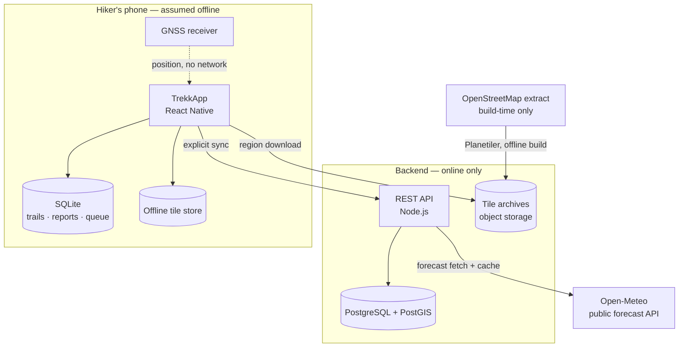
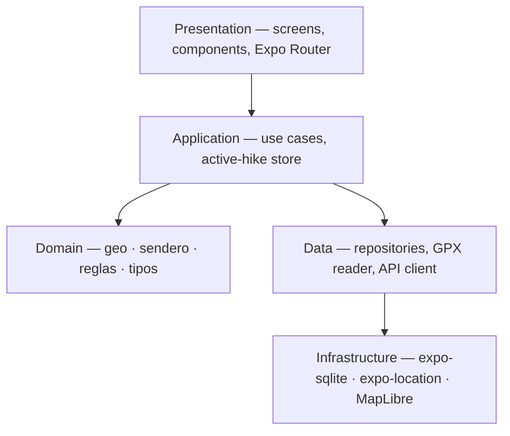
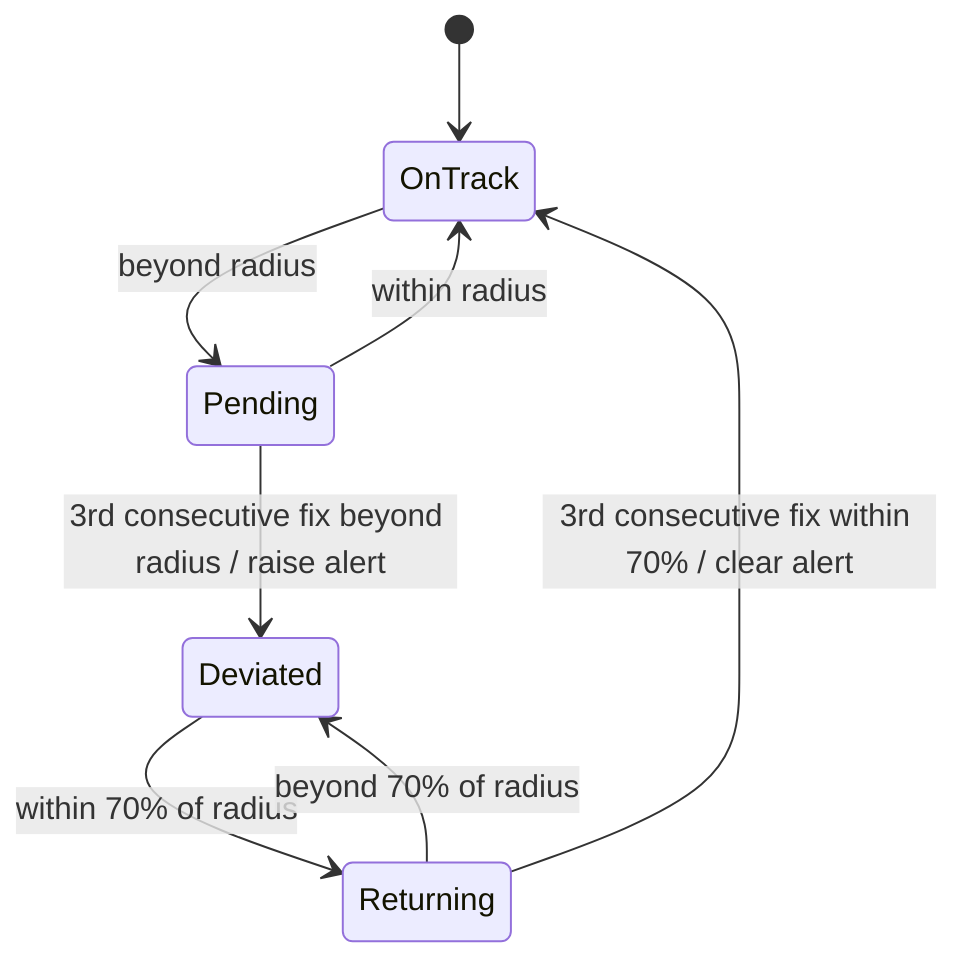
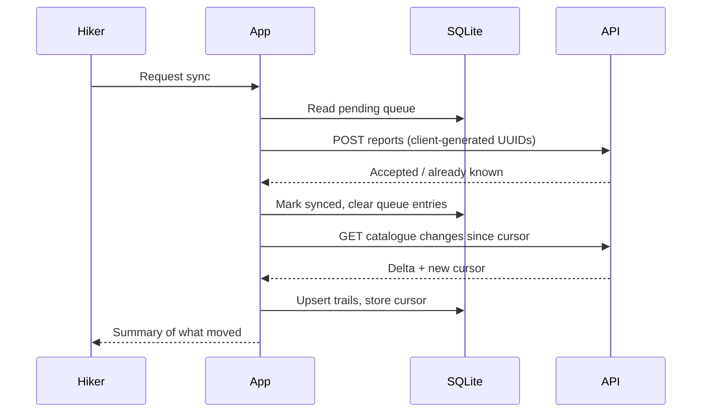

# TrekkApp — Architecture

Overview and runtime design. Detail lives in focused documents so a working
session only loads what it needs.

| Document | Read it when you are working on |
| --- | --- |
| **This file** | System shape, layers, runtime behaviour, sync, security |
| [data-model.md](./data-model.md) | Schema, tables, invariants, migrations |
| [integrations.md](./integrations.md) | Libraries, native capabilities, external APIs, providers |
| [adr/](./adr/README.md) | Why something is the way it is, before changing it |

- **Product**: mobile application for planning and navigating mountain trails
  without connectivity, with deviation alerts, experience-level gating and
  weather warnings.
- **Field of use**: Sierras de Córdoba, Argentina. No cellular coverage on the
  trail; no recharging in the field.
- **Status**: domain core and local persistence implemented. Map, GNSS, backend
  and sync are designed here and not yet built.

---

## 1. Architectural drivers

| Driver | Consequence |
| --- | --- |
| No network on the trail | Offline-first. The device is the primary store; the server is a replica the app reconciles with later. |
| GNSS works without cellular | Position is always available; only the basemap and remote data are lost. Everything safety-critical runs locally. |
| No recharge in the field | Battery is a first-class budget. Sampling rate and screen-off behaviour are design decisions, not defaults. |
| Safety-relevant output | Every warning issued and every user decision on it must be recorded. |
| Single developer, fixed deadline | Prefer managed tooling and boring technology over optimal technology. |
| User-contributed trails | Untrusted geometry must be validated and moderated before publication. |

### Quality attribute budgets

| Attribute | Target |
| --- | --- |
| Deviation alert latency | ≤ 15 s from the fix that confirms the deviation |
| Battery drain while navigating | ≤ 10 %/h with screen off |
| Cold start to usable map (offline) | ≤ 3 s |
| Position→alert evaluation | ≤ 50 ms for a 5 000-point track |
| Offline region size | ≤ 250 MB per downloaded region |

---

## 2. System context



**Invariant**: no external provider sits on the critical path once a hike is in
progress. Failure modes are tabulated in
[integrations.md § Failure matrix](./integrations.md#8-failure-matrix).

---

## 3. Stack overview

React Native on Expo · TypeScript `strict` · SQLite on the device · MapLibre
Native over self-generated vector tiles · Node.js with Fastify and
PostgreSQL/PostGIS on the server · Open-Meteo for forecast · Jest for tests.

Full inventory with rationale, versions and what is deliberately absent:
[integrations.md](./integrations.md).

---

## 4. Mobile application

### 4.1 Layers



The domain layer imports nothing outside itself — see
[ADR-0002](./adr/0002-framework-free-domain-layer.md). That is what lets it run
on Node in the test suite and behave identically on the trail.

### 4.2 Module map

| Module | Responsibility | State |
| --- | --- | --- |
| `dominio/geo` | Haversine distance, point-to-segment distance, distance to track | Built |
| `dominio/sendero` | Total distance, cumulative ascent, effort index, difficulty class | Built |
| `dominio/reglas` | Download gating, deviation hysteresis, weather thresholds | Built |
| `dominio/tipos` | Domain types and shared enumerations | Built |
| `datos/gpx` | GPX parsing, tolerant to malformed points | Built |
| `datos/esquema` | DDL and versioned migrations | Built |
| `datos/db` | Repositories over the local database | Built |
| `datos/api` | Typed REST client, sync protocol | Planned |
| `app/hike` | Active-hike session: sampling, evaluation loop, alert dispatch | Planned |
| `app/mapa` | Map view, offline region management | Planned |

### 4.3 Active-hike loop

The only continuously running process. It owns the battery budget.

| Concern | Decision |
| --- | --- |
| Sampling interval | 10 s moving, backing off to 30 s when displacement < 10 m between fixes |
| Accuracy class | Balanced; high accuracy only while an alert is open |
| Track lookup | Sliding window of segments around the last known index, falling back to a full scan when the window misses |
| Screen off | Android foreground service with a persistent notification; iOS background location mode |
| Alert delivery | Local notification plus sound; no network path involved |
| Persistence | Recorded track appended in batches, not per fix, to limit write amplification |
| Signal loss | Evaluation suspends and the suspension is shown. The last position is never presented as current. |

---

## 5. Offline cartography

| Aspect | Behaviour |
| --- | --- |
| Region granularity | Named regions (Sierras Grandes, Champaquí), not arbitrary bounding boxes |
| Device storage | MapLibre offline region packs, one per downloaded region |
| Eviction | Manual, from a storage screen. Regions are never removed automatically |
| Style | Bundled in the app, so a downloaded region renders identically with no network |
| Attribution | ODbL notice on the map surface and in the about screen |

Tiles are generated by the project rather than fetched from public servers:
[ADR-0006](./adr/0006-self-generated-map-tiles.md). Pipeline and providers:
[integrations.md § Data and infrastructure providers](./integrations.md#5-data-and-infrastructure-providers).

---

## 6. Rules engine

Pure functions, no I/O, exhaustively unit-tested. Thresholds are domain
constants and are the single place to tune behaviour.

| Rule | Input | Output | Key parameters |
| --- | --- | --- | --- |
| Difficulty classification | Distance, cumulative ascent | `principiante` / `intermedio` / `avanzado` | 100 m ascent ≡ 1 km flat; thresholds 8 and 18 |
| Download gating | Trail difficulty, declared level | Allowed, confirmation required, reason | Never blocks; escalates to explicit confirmation |
| Deviation | Distance to track, previous state | Alert open / close | 50 m radius, 3 fixes, 70 % re-entry |
| Weather | Forecast, thresholds | `ninguna` / `advertencia` / `riesgo` + reasons | 10 mm, 40 km/h, 0 °C; doubled ⇒ risk |

### Deviation state machine



Rationale for the two thresholds:
[ADR-0009](./adr/0009-deviation-alert-hysteresis.md).

---

## 7. Synchronisation

Explicit and user-initiated — never a background daemon
([ADR-0004](./adr/0004-explicit-user-initiated-sync.md)).



| Entity | Direction | Conflict policy |
| --- | --- | --- |
| Trails (catalogue) | Server → device | Server authoritative. The device never edits published trails. |
| Reports | Device → server | Append-only. Client UUID makes the write idempotent; conflicts cannot arise. |
| Contributed trails | Device → server | Uploaded as `pendiente_revision`; the server decides publication. |
| Profile (level) | Bidirectional | Last write wins by `actualizado_en`. |
| Forecast | Server → device | Overwrite; freshness carried by `obtenido_en`. |

Append-only user content ([ADR-0005](./adr/0005-append-only-user-content.md)) is
what removes the hard merge cases from the design.

**Failure handling**: the queue survives process death. Attempt counters back
off; a permanently failing entry surfaces in the UI rather than retrying
forever. Partial sync is a valid outcome and is reported as such.

---

## 8. Backend services

Built with Fastify and PostgreSQL, under `server/`. The derived attributes
are recomputed there with the very same domain modules the device runs,
imported rather than reimplemented, so the two cannot drift.

| Endpoint | Method | Purpose | Auth | Status |
| --- | --- | --- | --- | --- |
| `/api/auth/register` | POST | Account creation | Public | Built |
| `/api/auth/session` | POST | Sign in | Public | Built |
| `/api/auth/refresh` | POST | Exchange a refresh token, rotating it | Public | Built |
| `/api/auth/logout` | POST | Revoke every session of the account | Required | Built |
| `/api/auth/me` | GET, PATCH | Read and update the hiker's own profile | Required | Built |
| `/api/trails` | GET | Catalogue delta since cursor | Required | Built |
| `/api/trails/:id/track` | GET | Full track geometry | Required | Built |
| `/api/trails` | POST | Submit a contributed trail | Required | Built |
| `/api/reports` | POST | Submit trail-condition reports (idempotent) | Required | Built |
| `/api/reports` | GET | Reports delta since cursor, each row flagged as the caller's own or not | Required | Built |
| `/api/moderation/trails` | GET | Review queue for contributed trails | Moderator role | Built |
| `/api/moderation/trails/:id/review` | POST | Approve or reject a submission | Moderator role | Built |
| `/api/trails/:id/forecast` | GET | Cached forecast for the trail's coordinates | Required | Built |
| `/api/regions` | GET | Available offline tile regions and versions | Required | Built |
| `/api/regions/:id/style.json` | GET | MapLibre style for a region | Public | Built |
| `/api/regions/:id/tiles/{z}/{x}/{y}.pbf` | GET | One vector tile | Public | Built |

The style and the tiles are public while the listing is not. They are
OpenStreetMap derived data the licence lets anyone redistribute, and the
component that fetches them is MapLibre's own native downloader, which manages
its requests outside the application's HTTP client and cannot be relied on to
carry a bearer token on each of the thousands of tiles a region comprises.

The delta cursor is formatted by PostgreSQL and never rebuilt from a
JavaScript `Date`. A `Date` holds milliseconds while the column holds
microseconds, so a cursor built in the application truncates the value and
the last row of every page is returned again on the following
synchronisation, indefinitely.

| Concern | Decision |
| --- | --- |
| Contributed trail validation | Point count, bounding box within the covered region, self-intersection and implausible speed checks before entering moderation |
| Derived attributes | Recomputed server-side on ingest; client values are never trusted ([ADR-0003](./adr/0003-derived-attributes-computed-on-write.md)) |
| Forecast caching | Per trail and date, TTL 3 h; the upstream provider is never called per device. Asked about the midpoint of the track, not its start. When the provider does not answer, anything stored is served and labelled stale rather than withheld |
| Rate limiting | Per account and per IP on write endpoints |

Storage details: [data-model.md § Server model](./data-model.md#5-server-model-postgresql--postgis).

---

## 9. Security

| Area | Measure |
| --- | --- |
| Authentication | Email and password, Argon2id hashing, JWT access token with refresh rotation |
| Token storage | `expo-secure-store` (Keychain / Keystore), never `AsyncStorage` |
| Transport | HTTPS only; certificate pinning deferred, tracked below |
| Authorisation | Roles: hiker, moderator. Contributed trails and reports are owner-scoped |
| Input validation | Schema validation at the API boundary; the app additionally validates imported GPX before persisting |
| Location data | Recorded tracks stay on the device unless the hiker explicitly publishes them |
| Data at rest | SQLite unencrypted for the prototype; stored data is trail geometry and the user's own notes. SQLCipher is a documented future step |
| Secrets | Never in the repository; EAS environment variables for build-time values |

---

## 10. Traceability

`alertas_emitidas` records every warning the system raised, its detail, and
whether the hiker accepted it. In a system whose subject is personal safety this
is evidence, not telemetry: it supports the claim that the system warned, and
what the person decided.

Scope: level-gating confirmations, weather warnings shown before download, and
deviation alerts raised during a hike. It is local and is not transmitted.

---

## 11. Testing strategy

| Level | Scope | Tooling | Status |
| --- | --- | --- | --- |
| Unit | Domain functions, GPX parsing | Jest on Node | 57 tests passing |
| Integration | Repositories against a real SQLite file | Jest + dev build | Planned |
| Contract | Sync protocol, app client vs API schemas | Shared schema definitions | Planned |
| Scenario | Signal loss, interrupted sync, duplicate submission, malformed GPX | Jest + fixtures | Partially covered |
| Field | Real hike on a Sierras de Córdoba trail: battery, accuracy, alert behaviour | Manual, instrumented | Planned |

Field testing is not optional. Signal loss and battery behaviour are the two
variables the project exists to address, and neither can be simulated honestly.

---

## 12. Repository layout

```
trekkapp/
├── docs/
│   ├── architecture.md      this document
│   ├── data-model.md        schema and invariants
│   ├── integrations.md      libraries, APIs, providers
│   └── adr/                 architecture decision records
├── src/
│   ├── dominio/             pure business logic, no I/O
│   ├── datos/               persistence, parsing, API client
│   ├── app/                 use cases and session stores
│   └── ui/                  screens and components (Expo Router)
├── assets/
└── server/                  Node.js API (planned, same repository)
```

Code and comments are written in Spanish, matching the dissertation.
Documentation aimed at tooling — these files included — is in English.

---

## 13. Out of scope

Automatic rerouting after a deviation · emergency transmission to third parties
· satellite communicators and personal beacons · wearables · background sync ·
in-app drawing of new routes · commerce · replacing official protected-area
registries.

---

## 14. Open decisions

Resolved items become records in [adr/](./adr/README.md).

| Question | Blocking | Resolve by |
| --- | --- | --- |
| Region granularity and tile archive size for the Sierras extract | Yes, map sprint | Spike: generate one region, measure |
| Background location behaviour under iOS suspension | Yes, hike sprint | Spike on a physical device |
| Certificate pinning on the API client | No | Before store release |
| SQLCipher for local data at rest | No | Only if profile data broadens |
| Moderation workflow: who reviews contributed trails in the prototype | No | Before the contribution flow ships |
| Object storage provider for tile archives | No | Before the map sprint ends |
