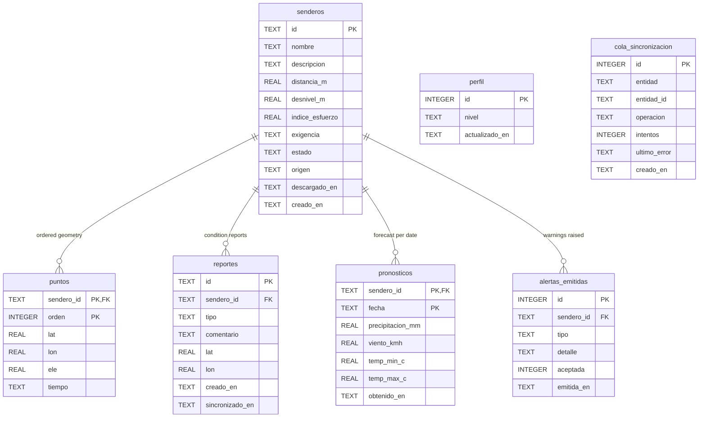

# Data Model

Definition of the local (device) and remote (server) data models.

- Local schema of record: `src/datos/esquema.ts`. This document describes it;
  the file is authoritative. If they diverge, the file wins and this document
  must be corrected.
- Related: [architecture.md](./architecture.md) · [ADR-0001](./adr/0001-offline-first-local-store.md)
  · [ADR-0003](./adr/0003-derived-attributes-computed-on-write.md)
  · [ADR-0005](./adr/0005-append-only-user-content.md)

---

## 1. Local schema (SQLite)

Seven tables and two indexes. Current version: **1**.

`perfil` and `cola_sincronizacion` have no foreign keys: the first holds a
single row of device-scoped settings, the second references entities by name and
identifier rather than by relation, so an entry survives the deletion of what it
points at.

### 1.1 `senderos`

| Column | Type | Constraints | Notes |
| --- | --- | --- | --- |
| `id` | TEXT | PK | UUID; generated by the server for catalogue trails, by the device for contributions |
| `nombre` | TEXT | NOT NULL | |
| `descripcion` | TEXT | | |
| `distancia_m` | REAL | NOT NULL | Derived from `puntos` |
| `desnivel_m` | REAL | NOT NULL | Derived; cumulative ascent with altitude-noise filter |
| `indice_esfuerzo` | REAL | NOT NULL | Derived; flat-equivalent kilometres |
| `exigencia` | TEXT | NOT NULL, CHECK | `principiante` \| `intermedio` \| `avanzado` |
| `estado` | TEXT | NOT NULL, CHECK, default `pendiente_revision` | `publicado` \| `pendiente_revision` |
| `origen` | TEXT | NOT NULL, CHECK | `precargado` \| `importado` |
| `descargado_en` | TEXT | | ISO-8601; null means catalogue-only, geometry not held |
| `creado_en` | TEXT | NOT NULL | ISO-8601 |

### 1.2 `puntos`

| Column | Type | Constraints | Notes |
| --- | --- | --- | --- |
| `sendero_id` | TEXT | PK, FK → `senderos(id)` ON DELETE CASCADE | |
| `orden` | INTEGER | PK | Zero-based sequence position |
| `lat`, `lon` | REAL | NOT NULL | Decimal degrees, WGS 84 |
| `ele` | REAL | | Metres above sea level; nullable, not every GPX carries it |
| `tiempo` | TEXT | | ISO-8601 from the source file |

Stored relationally rather than as a serialised blob because the sequence is
scanned on every position fix; a blob would force a full parse per evaluation.

### 1.3 `perfil`

| Column | Type | Constraints |
| --- | --- | --- |
| `id` | INTEGER | PK, CHECK (`id = 1`) — enforces a single row |
| `nivel` | TEXT | NOT NULL, CHECK against the three levels |
| `actualizado_en` | TEXT | NOT NULL — the tiebreaker for last-write-wins sync |

### 1.4 `reportes`

| Column | Type | Constraints | Notes |
| --- | --- | --- | --- |
| `id` | TEXT | PK | UUID generated on the device; the idempotency key for upload |
| `sendero_id` | TEXT | NOT NULL, FK CASCADE | |
| `tipo` | TEXT | NOT NULL | Report category |
| `comentario` | TEXT | | Free text |
| `lat`, `lon` | REAL | | Where the observation was made; nullable |
| `creado_en` | TEXT | NOT NULL | |
| `sincronizado_en` | TEXT | | Null until confirmed by the server |

Index `idx_reportes_sendero` on `sendero_id`.

### 1.5 `cola_sincronizacion`

| Column | Type | Constraints |
| --- | --- | --- |
| `id` | INTEGER | PK AUTOINCREMENT |
| `entidad` | TEXT | NOT NULL |
| `entidad_id` | TEXT | NOT NULL |
| `operacion` | TEXT | NOT NULL |
| `intentos` | INTEGER | NOT NULL, default 0 |
| `ultimo_error` | TEXT | |
| `creado_en` | TEXT | NOT NULL |
| — | — | UNIQUE (`entidad`, `entidad_id`, `operacion`) |

The uniqueness constraint is the mechanism that prevents an interrupted sync
from enqueuing the same work twice.

### 1.6 `pronosticos`

| Column | Type | Constraints |
| --- | --- | --- |
| `sendero_id` | TEXT | PK, FK CASCADE |
| `fecha` | TEXT | PK — forecast date, `YYYY-MM-DD` |
| `precipitacion_mm`, `viento_kmh`, `temp_min_c`, `temp_max_c` | REAL | NOT NULL |
| `obtenido_en` | TEXT | NOT NULL — when it was retrieved, so the UI can state its age |

A cached forecast is always rendered with its age. A stale forecast must never
read as current.

### 1.7 `alertas_emitidas`

| Column | Type | Constraints | Notes |
| --- | --- | --- | --- |
| `id` | INTEGER | PK AUTOINCREMENT | |
| `sendero_id` | TEXT | FK ON DELETE SET NULL | The record outlives the trail |
| `tipo` | TEXT | NOT NULL, CHECK | `desvio` \| `clima` \| `nivel` |
| `detalle` | TEXT | | Reason text shown to the hiker |
| `aceptada` | INTEGER | | 1/0/null — null when the warning required no decision |
| `emitida_en` | TEXT | NOT NULL | |

Index `idx_alertas_sendero`. This is an audit trail, not telemetry: it supports
the claim that the system warned, and records what the person decided. It stays
on the device.

---

## 2. Invariants

| # | Invariant | Enforced by |
| --- | --- | --- |
| 1 | Derived attributes always match the stored geometry | Computed inside the write path; never accepted as input ([ADR-0003](./adr/0003-derived-attributes-computed-on-write.md)) |
| 2 | A report and its queue entry exist together or not at all | Single transaction |
| 3 | A contributed trail is never published without review | `estado` defaults to `pendiente_revision` for `origen = importado` |
| 4 | Exactly one profile row | `CHECK (id = 1)` |
| 5 | Deleting a trail removes its geometry, reports and forecasts | `ON DELETE CASCADE`, with `PRAGMA foreign_keys = ON` |
| 6 | Warning history survives trail deletion | `ON DELETE SET NULL` on `alertas_emitidas` |
| 7 | The same pending operation is never queued twice | UNIQUE constraint on the queue |

---

## 3. Conventions

| Topic | Rule |
| --- | --- |
| Timestamps | TEXT, ISO-8601 with UTC offset. SQLite has no date type; string ordering is chronological. |
| Identifiers | TEXT UUID for entities that cross the device/server boundary; INTEGER autoincrement for device-local rows. |
| Coordinates | REAL decimal degrees, WGS 84. No spatial types on the device. |
| Booleans | INTEGER 0/1, nullable where a third "not applicable" state exists. |
| Naming | Spanish, snake_case, matching the domain vocabulary of the dissertation. |
| Enumerations | Constrained with CHECK rather than lookup tables; the sets are small and stable. |

---

## 4. Migrations

| Aspect | Rule |
| --- | --- |
| Storage | Ordered array of SQL scripts in `src/datos/esquema.ts` |
| Version tracking | `PRAGMA user_version`, set to the index of the last applied script |
| Application | On open, forward-only, inside `abrirBd()` |
| Editing history | Applied migrations are immutable. Corrections ship as a new migration. |
| Destructive changes | Not permitted without an explicit data-preservation step; an app update must never discard downloaded trails. |
| Rollback | None. Forward fixes only. |

---

## 5. Server model (PostgreSQL + PostGIS)

Planned; not yet built. It mirrors the local model with three differences.

| Aspect | Server | Device |
| --- | --- | --- |
| Geometry | `LINESTRING` in a PostGIS column with a GiST index, enabling proximity queries | Ordered rows in `puntos` |
| Ownership | Every contribution and report carries an owner and a moderation state | Device-local only |
| Change tracking | Monotonic `updated_at` plus tombstone rows for deletions, driving the delta cursor | `sincronizado_en` and the queue |

Derived attributes are recomputed server-side on ingest. The server does not
trust values sent by a client, for the same reason the device does not trust
values sent by a contributor.

### Sync-relevant fields

| Field | Purpose |
| --- | --- |
| `updated_at` | Delta cursor; the device requests changes strictly after its stored value |
| Tombstones | Propagate deletions to devices that were offline when they happened |
| Client UUID on reports | Makes upload idempotent; a retry cannot duplicate a report |

Conflict policy per entity is defined in
[architecture.md § Synchronisation](./architecture.md#7-synchronisation).
