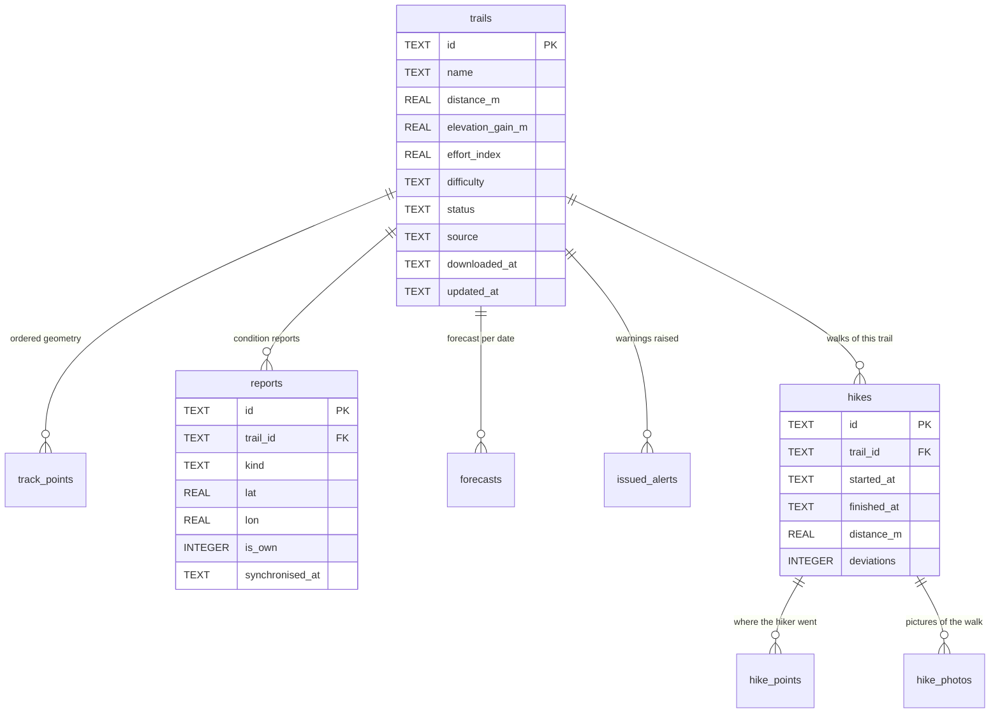

# Data Model

Definition of the local (device) and remote (server) data models.

- Local schema of record: `src/data/schema.ts`. This document describes it;
  the file is authoritative. If they diverge, the file wins and this document
  must be corrected.
- Server schema of record: `server/src/db/migrations/`.
- Related: [architecture.md](./architecture.md) · [ADR-0001](./adr/0001-offline-first-local-store.md)
  · [ADR-0003](./adr/0003-derived-attributes-computed-on-write.md)
  · [ADR-0005](./adr/0005-append-only-user-content.md)

---

## 1. Local schema (SQLite)

Eleven tables. Current version: **8**.

The tables divide into three groups, and the division is the one that matters
when reading the schema.

**The catalogue**, which describes trails and belongs to everybody: `trails`,
`track_points`, `forecasts`. It is replaceable. Deleting it costs a
synchronisation and a download.

**What this hiker did**, which exists nowhere else: `hikes`, `hike_points`,
`hike_photos`, `issued_alerts`, and the `reports` they wrote. Losing it loses
the record of an afternoon.

**The machinery**: `profile`, `sync_queue`, `sync_state`.

### 1.1 `trails`

| Column | Type | Constraints | Notes |
| --- | --- | --- | --- |
| `id` | TEXT | PK | UUID. Derived from the source ways for the generated catalogue, assigned by the server for a contribution, generated on the device for an import |
| `name` | TEXT | NOT NULL | |
| `description` | TEXT | | |
| `distance_m` | REAL | NOT NULL | Derived from `track_points` |
| `elevation_gain_m` | REAL | NOT NULL | Derived; cumulative ascent with an altitude-noise filter |
| `effort_index` | REAL | NOT NULL | Derived; flat-equivalent kilometres |
| `difficulty` | TEXT | NOT NULL, CHECK | `beginner` \| `intermediate` \| `advanced` |
| `status` | TEXT | NOT NULL, CHECK, default `local` | `published` \| `withdrawn` \| `local` |
| `source` | TEXT | NOT NULL, CHECK | `preloaded` \| `imported` |
| `downloaded_at` | TEXT | | ISO-8601; marks the trail as one the hiker intends to walk |
| `created_at` | TEXT | NOT NULL | ISO-8601 |
| `updated_at` | TEXT | | Mirrors the server's cursor value, so a trail already current is not rewritten on every delta |

`status` replaced a `pending_review` state that described a queue no account
could work. See [ADR-0011](./adr/0011-system-validated-contributions.md).

### 1.2 `track_points`

| Column | Type | Constraints | Notes |
| --- | --- | --- | --- |
| `trail_id` | TEXT | PK, FK → `trails`, ON DELETE CASCADE | |
| `position` | INTEGER | PK | Order along the track, from zero |
| `lat`, `lon` | REAL | NOT NULL | WGS 84 decimal degrees |
| `ele` | REAL | | Metres; absent in tracks exported by some tools |
| `time` | TEXT | | ISO-8601, when the source recorded one |

Rows rather than a blob, because the sequence is walked on every position fix
during a hike and a blob would force a full parse each time.

### 1.3 `profile`

| Column | Type | Constraints | Notes |
| --- | --- | --- | --- |
| `id` | INTEGER | PK, CHECK (id = 1) | One row, enforced |
| `name`, `email` | TEXT | | |
| `level` | TEXT | NOT NULL, CHECK | The declared level the warnings are weighed against |
| `theme` | TEXT | NOT NULL, CHECK, default `light` | Stored with the profile because it is a decision about power draw and night vision |
| `user_id` | TEXT | | The account on the server. What tells the device whether it is holding somebody else's data |
| `updated_at` | TEXT | NOT NULL | |

No credential is kept here. Tokens live in the Keychain or Keystore. See
[ADR-0015](./adr/0015-offline-identity-is-a-claim.md).

### 1.4 `reports`

| Column | Type | Constraints | Notes |
| --- | --- | --- | --- |
| `id` | TEXT | PK | UUID generated on the device. This is what makes the upload idempotent |
| `trail_id` | TEXT | FK → `trails`, ON DELETE CASCADE | |
| `kind` | TEXT | NOT NULL | An identifier from the catalogue in `src/domain/reports.ts`, not free text |
| `comment` | TEXT | | Required only for the open kind |
| `lat`, `lon` | REAL | | Anchored to the nearest point of the track, so two people reporting one ford leave one mark |
| `created_at` | TEXT | NOT NULL | |
| `synchronised_at` | TEXT | | Null while the report is provisional |
| `is_own` | INTEGER | NOT NULL, default 1 | A report of this hiker's comes back from the server indistinguishable from anybody else's |

### 1.5 `sync_queue`

| Column | Type | Constraints | Notes |
| --- | --- | --- | --- |
| `id` | INTEGER | PK AUTOINCREMENT | |
| `entity`, `entity_id`, `operation` | TEXT | NOT NULL, UNIQUE together | What stops an interrupted sync enqueuing the same work twice |
| `attempts` | INTEGER | NOT NULL, default 0 | |
| `last_error` | TEXT | | The reason the server gave |
| `created_at` | TEXT | NOT NULL | |

### 1.6 `sync_state`

| Column | Type | Constraints | Notes |
| --- | --- | --- | --- |
| `key` | TEXT | PK | `cursor.trails`, `cursor.reports` |
| `value` | TEXT | NOT NULL | The server's cursor, kept as the server formatted it |
| `updated_at` | TEXT | NOT NULL | |

A table rather than a preferences file, so a cursor advances inside the same
transaction that stores the rows it accounts for.

### 1.7 `forecasts`

| Column | Type | Constraints | Notes |
| --- | --- | --- | --- |
| `trail_id` | TEXT | PK, FK → `trails`, ON DELETE CASCADE | |
| `date` | TEXT | PK | |
| `precipitation_mm`, `wind_kmh`, `min_temp_c`, `max_temp_c` | REAL | NOT NULL | |
| `obtained_at` | TEXT | NOT NULL | Shown with the warning, so a stale forecast says so |

### 1.8 `issued_alerts`

| Column | Type | Constraints | Notes |
| --- | --- | --- | --- |
| `id` | INTEGER | PK AUTOINCREMENT | |
| `trail_id` | TEXT | FK → `trails`, ON DELETE SET NULL | Survives the trail, which is the point |
| `kind` | TEXT | NOT NULL, CHECK | `deviation` \| `weather` \| `level` |
| `detail` | TEXT | | |
| `accepted` | INTEGER | | What the person decided |
| `issued_at` | TEXT | NOT NULL | |

Traceability. In a system whose subject is safety this is evidence, not an
accessory.

### 1.9 `hikes`

| Column | Type | Constraints | Notes |
| --- | --- | --- | --- |
| `id` | TEXT | PK | UUID |
| `trail_id` | TEXT | FK → `trails`, ON DELETE CASCADE | |
| `started_at` | TEXT | NOT NULL | |
| `finished_at` | TEXT | | Null while the walk is open, or if the application was killed |
| `distance_m` | REAL | NOT NULL, default 0 | What was actually walked, which differs from the trail |
| `deviations` | INTEGER | NOT NULL, default 0 | How many times the alert opened. Kept here so a walk keeps its own record even if the alert log is pruned |

### 1.10 `hike_points`

| Column | Type | Constraints | Notes |
| --- | --- | --- | --- |
| `hike_id` | TEXT | PK, FK → `hikes`, ON DELETE CASCADE | |
| `position` | INTEGER | PK | |
| `lat`, `lon` | REAL | NOT NULL | |
| `ele` | REAL | | |
| `time` | TEXT | NOT NULL | |

Written as each fix arrives rather than buffered. A hike lasts hours and the
application can be killed at any point; what is on disk is what survives.

### 1.11 `hike_photos`

| Column | Type | Constraints | Notes |
| --- | --- | --- | --- |
| `id` | TEXT | PK | UUID |
| `hike_id` | TEXT | FK → `hikes`, ON DELETE CASCADE | |
| `uri` | TEXT | NOT NULL | Where the file sits in the application's own directory. The image is not in the database |
| `lat`, `lon` | REAL | | Where it was taken, when the receiver had answered |
| `taken_at` | TEXT | NOT NULL | |
| `note` | TEXT | | |

These never leave the device. See
[ADR-0014](./adr/0014-photographs-stay-on-the-device.md).

## 2. Invariants

| # | Invariant | Enforced by |
| --- | --- | --- |
| 1 | Derived attributes always match the stored geometry | Computed inside the write path; never accepted as input ([ADR-0003](./adr/0003-derived-attributes-computed-on-write.md)) |
| 2 | A report and its queue entry exist together or not at all | Single transaction |
| 3 | A trail imported from a file stays on the phone that imported it | `status` defaults to `local` for `source = imported`; only the server publishes ([ADR-0011](./adr/0011-system-validated-contributions.md)) |
| 4 | Exactly one profile row | `CHECK (id = 1)` |
| 5 | Deleting a trail removes its geometry, reports and forecasts | `ON DELETE CASCADE`, with `PRAGMA foreign_keys = ON` |
| 6 | Warning history survives trail deletion | `ON DELETE SET NULL` on `issued_alerts` |
| 8 | A walk takes its points and its photographs with it | `ON DELETE CASCADE` on `hike_points` and `hike_photos`; the image files are deleted by the caller |
| 9 | Every identifier that crosses to the server is a UUID | Generated from SQLite's own random source, never from the clock |
| 7 | The same pending operation is never queued twice | UNIQUE constraint on the queue |

---

## 3. Conventions

| Topic | Rule |
| --- | --- |
| Timestamps | TEXT, ISO-8601 with UTC offset. SQLite has no date type; string ordering is chronological. |
| Identifiers | TEXT UUID for entities that cross the device/server boundary; INTEGER autoincrement for device-local rows. |
| Coordinates | REAL decimal degrees, WGS 84. No spatial types on the device. |
| Booleans | INTEGER 0/1, nullable where a third "not applicable" state exists. |
| Naming | English, snake_case. The code, the schema and the comments are English; what the hiker reads is Spanish. |
| Enumerations | Constrained with CHECK rather than lookup tables; the sets are small and stable. |

---

## 4. Migrations

| Aspect | Rule |
| --- | --- |
| Storage | Ordered array of SQL scripts in `src/data/schema.ts`, currently eight |
| Version tracking | `PRAGMA user_version`, set to the index of the last applied script |
| Application | On open, forward-only, inside `openDatabase()` |
| Verification | Exercised against real SQLite in `src/data/__tests__/schema.test.ts`. A migration runs once per device, with whatever that device holds, which makes it the riskiest code here |
| Editing history | Applied migrations are immutable. Corrections ship as a new migration. |
| Destructive changes | Not permitted without an explicit data-preservation step; an app update must never discard downloaded trails. |
| Rollback | None. Forward fixes only. |

---

## 5. Server model (PostgreSQL, without PostGIS)

Built, under `server/src/db/migrations`, in two migrations. PostGIS is not
used: geometry is ordered rows, as on the device, deferred under
[ADR-0010](./adr/0010-defer-postgis.md) until a requirement asks for a
proximity query. It mirrors the local model with three differences.

| Aspect | Server | Device |
| --- | --- | --- |
| Geometry | Ordered rows in `track_points`, as on the device. A PostGIS `LINESTRING` with a GiST index was specified and is deferred until a requirement asks for a proximity query | Ordered rows in `track_points` |
| Ownership | Every contribution and report carries an owner. There is no moderation state and no moderator ([ADR-0011](./adr/0011-system-validated-contributions.md)) | Device-local only |
| Change tracking | Monotonic `updated_at` plus tombstone rows for deletions, driving the delta cursor. The cursor is formatted by the database to keep microsecond precision, which a JavaScript `Date` loses | `synchronised_at` and the queue |

Derived attributes are recomputed server-side on ingest, by importing the very
same domain module the device runs rather than reimplementing it. The server
does not trust values sent by a client, for the same reason the device does
not trust values sent by a contributor.

The server also serves what the offline map needs and the database does not
hold: the style, the glyph ranges the labels are drawn with, the basemap tiles
and the contour tiles. Those come from files on disk, not from PostgreSQL.

### Sync-relevant fields

| Field | Purpose |
| --- | --- |
| `updated_at` | Delta cursor; the device requests changes strictly after its stored value |
| Tombstones | Propagate deletions to devices that were offline when they happened |
| Client UUID on reports | Makes upload idempotent; a retry cannot duplicate a report |

Conflict policy per entity is defined in
[architecture.md § Synchronisation](./architecture.md#7-synchronisation).
